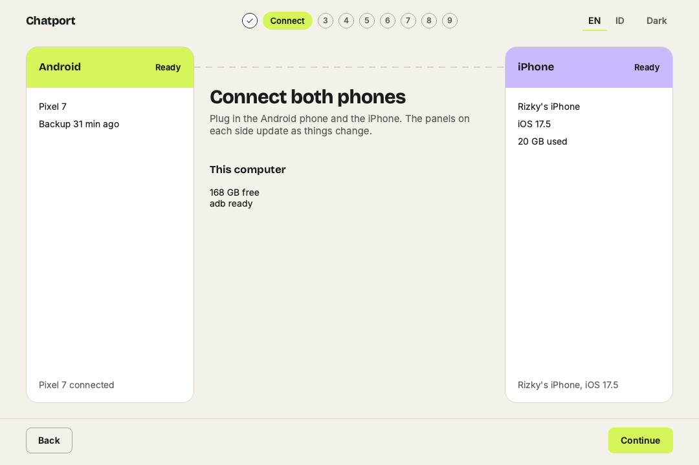
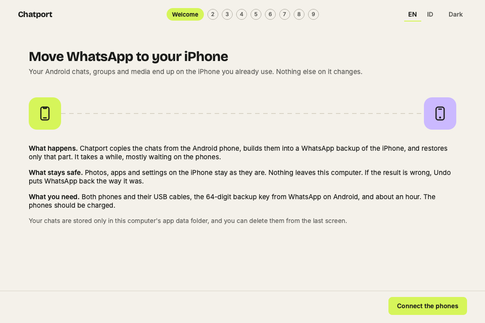
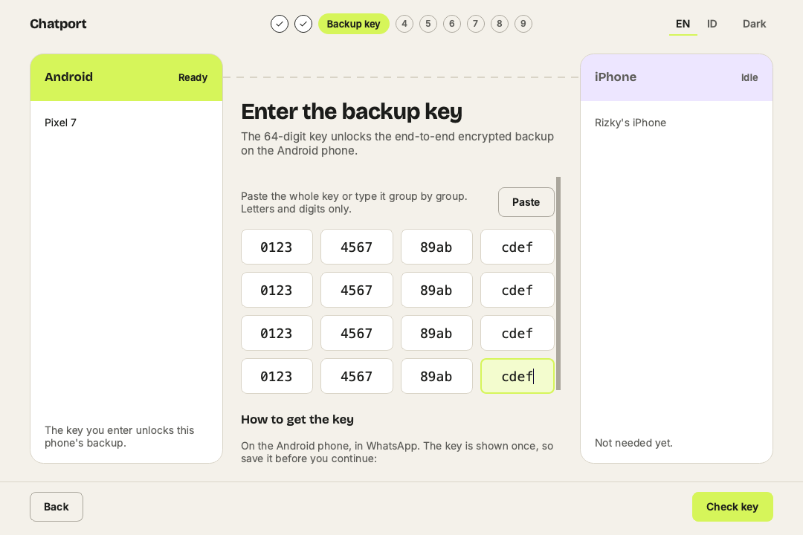
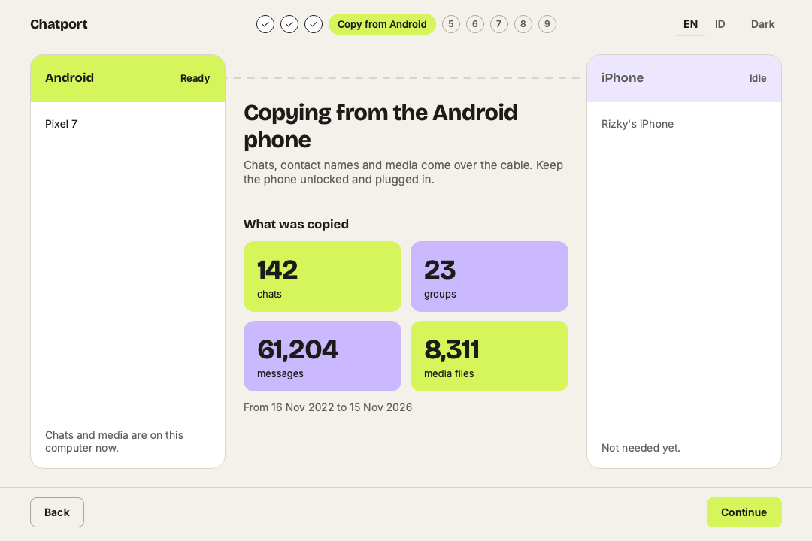
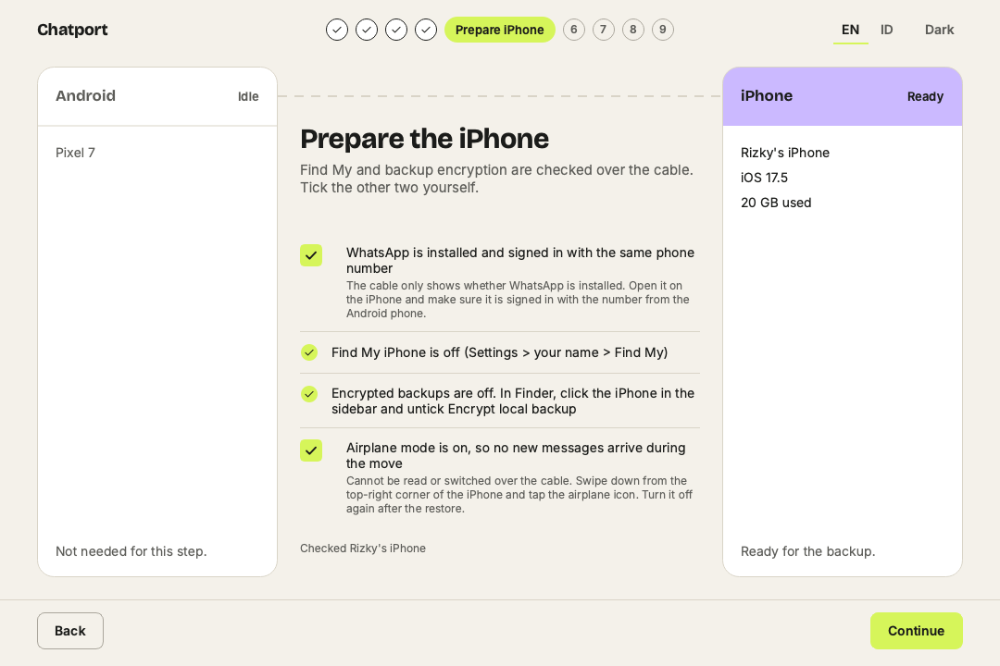
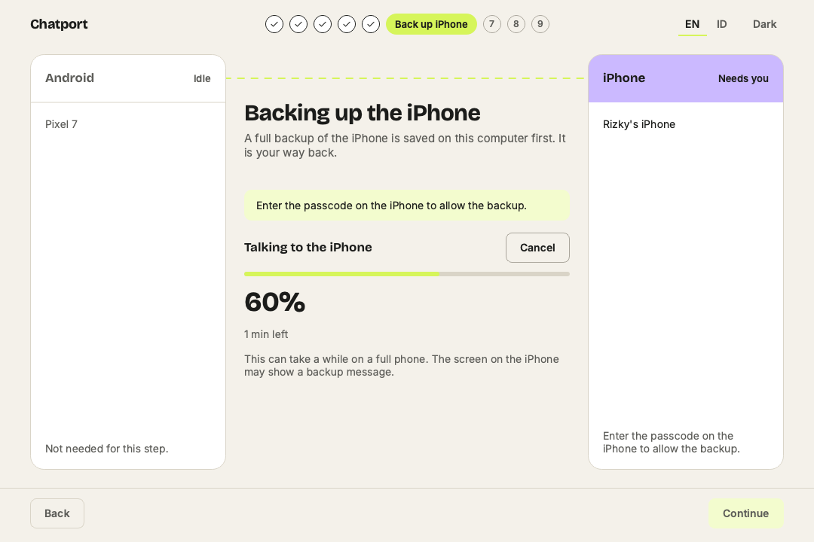
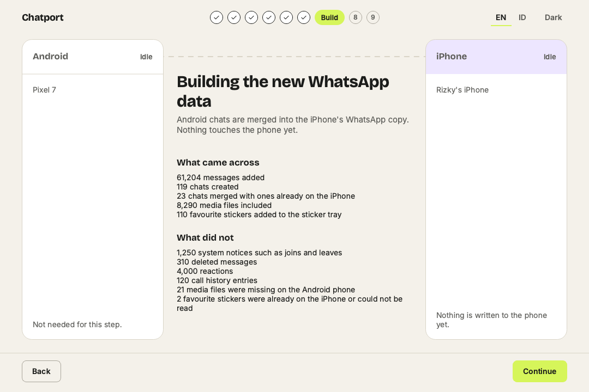
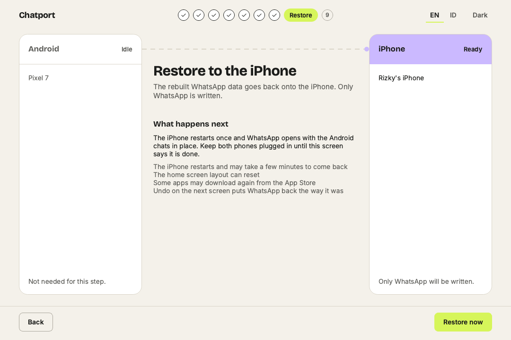
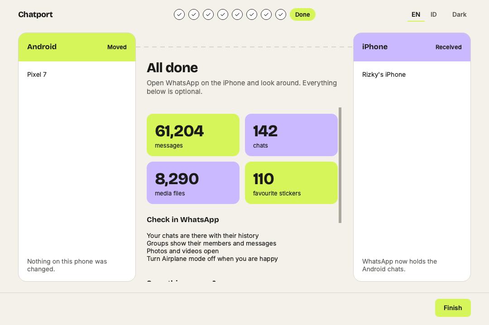

<p align="center">
  
</p>

<h1 align="center">Chatport</h1>

<p align="center">Move WhatsApp to the iPhone you already use.</p>

<p align="center">
  <a href="LICENSE"></a>
  <a href="https://github.com/rhamaxv/chatport/actions/workflows/ci.yml"></a>
  <a href="https://github.com/rhamaxv/chatport/releases/latest"></a>
</p>

<p align="center">
  <a href="https://github.com/rhamaxv/chatport/releases/latest"><b>Download</b></a> ·
  <a href="docs/guides"><b>Guides</b></a> ·
  <a href="https://github.com/rhamaxv/wamove"><b>Engine</b></a>
</p>

<p align="center">
  
</p>

## Why Chatport

WhatsApp's own Android to iPhone transfer only works while the iPhone is being set up, so an iPhone you already use has to be erased first. The paid tools that avoid the erase are closed source and ask you to trust them with your chats. Chatport is free and open source, and it never leaves your computer. It touches only WhatsApp's part of a backup of the iPhone and restores that part alone, so your photos, apps and settings stay as they are.

## How it works

1. WhatsApp on the Android phone has an end-to-end encrypted backup. Chatport copies it, plus the media folders, over the USB cable with Google's `adb`.
2. You enter the 64-digit key that WhatsApp shows on the Android phone. Chatport tries it on a small sample first, then decrypts the backup on this computer. The key stays in memory and never reaches disk or logs.
3. Chatport makes a full backup of the iPhone on this computer. That backup is your way back and is never modified.
4. It makes a WhatsApp-only copy of that backup and merges the Android chats, groups and media into the copy. Nothing on the iPhone changes yet.
5. It restores only that copy. The iPhone restarts once and WhatsApp opens with the Android chats in place. Undo restores the untouched WhatsApp-only copy saved before the merge.

## What moves and what does not

| Moves | Does not move |
|---|---|
| One-to-one chats with their history | Reactions |
| Groups with their history and members | Polls |
| Photos and videos | Links from a reply to the quoted message |
| Voice notes | Edit history of edited messages |
| Documents | Call history |
| Stickers and GIFs in chats, and your favourite stickers | Statuses |
| Shared locations and contact cards | Channels |
| Timestamps and sender names | Disappearing-message timers (they need to be set again) |
| Starred messages | WhatsApp Business is not supported |

The Build step shows exactly what came across and what was skipped before anything is written to the iPhone.

## Requirements

| | macOS | Windows | Linux |
|---|---|---|---|
| System | macOS 12 Monterey or newer, Apple silicon or Intel | Windows 10 or 11, 64-bit | 64-bit, glibc 2.35 or newer (Ubuntu 22.04, Fedora 38, Debian 12 or later) |
| iPhone driver | Nothing extra | Apple Mobile Device Support, which comes with iTunes from the Microsoft Store | `usbmuxd` and `libimobiledevice-utils` from your package manager |
| adb | Downloaded by Chatport on first use, or your own from Homebrew | Downloaded by Chatport on first use, or your own on PATH | Downloaded by Chatport on first use; some distributions also need the udev rules package |
| Optional | `ffmpeg` for video thumbnails | | `ffmpeg` for video thumbnails |
| Guide | [docs/guides/macos.md](docs/guides/macos.md) | [docs/guides/windows.md](docs/guides/windows.md) | [docs/guides/linux.md](docs/guides/linux.md) |

On every system you also need:

- Both phones, charged, each with a USB cable that carries data and not only charge.
- WhatsApp on the iPhone installed and registered with the same phone number as on Android.
- An end-to-end encrypted backup on the Android phone and its 64-digit key.
- About an hour, most of it waiting on the phones.
- Free disk space for a full backup of the iPhone plus about twice the size of your WhatsApp media.

## Install

Download from the [latest release](https://github.com/rhamaxv/chatport/releases/latest). The builds are not code signed yet, so each system asks once before the first start.

**macOS**: open `Chatport-<version>.dmg` and drag Chatport to Applications. On first start macOS says it cannot verify the developer. Click Done, open System Settings > Privacy & Security, and click Open Anyway. Or run `xattr -dr com.apple.quarantine /Applications/Chatport.app`. Details in the [macOS guide](docs/guides/macos.md).

**Windows**: run `Chatport-<version>-Setup.exe`. SmartScreen shows "Windows protected your PC". Click More info, then Run anyway. Install iTunes from the Microsoft Store first if you have not, so the Apple Mobile Device Service is present. Details in the [Windows guide](docs/guides/windows.md).

**Linux**: download `Chatport-<version>-x86_64.AppImage`, run `chmod +x Chatport-*.AppImage`, then start it. Install `usbmuxd` with your package manager first. If the AppImage does not start, install `libfuse2` or run it with `--appimage-extract-and-run`. Details in the [Linux guide](docs/guides/linux.md).

## The nine steps

A left rail shows where you are. Each step is saved, so if you close the app it resumes at the first unfinished step. Every screen also exists in dark mode and in Indonesian.

| | | |
|:---:|:---:|:---:|
| <br>**1. Welcome.** What happens, what stays safe, what you need. | <br>**2. Connect.** The two phone panels show each phone's live state; the middle shows this computer. | <br>**3. Backup key.** Paste or type the 64-digit key; it is checked on a small sample. |
| <br>**4. Copy from Android.** Chats, contact names and media come over the cable. | <br>**5. Prepare iPhone.** Same number, Find My off, encrypted backups off, Airplane mode on. | <br>**6. Back up iPhone.** A full backup is saved on this computer first. |
| <br>**7. Build.** Android chats are merged into a WhatsApp-only copy; a report shows what came across. | <br>**8. Restore.** Only WhatsApp is written back. The iPhone restarts once. | <br>**9. Done.** Check the chats, Undo if needed, delete the private copies. |

## Privacy

- Nothing is uploaded anywhere. There is no account, no telemetry and no crash reporting.
- The only network call is the download of Google's official Android platform-tools from `dl.google.com` on first use, and only if `adb` is not already installed.
- The 64-digit key is held in memory only. It is never written to disk or to the log, and the log scrubs anything that looks like one.
- Decrypted chats, media and iPhone backups live in a folder that only your user can read: `~/Library/Application Support/Chatport` on macOS, `%LOCALAPPDATA%\Chatport` on Windows, `~/.local/share/chatport` on Linux.
- The last screen has a Delete button that removes the decrypted chats, media and WhatsApp copies, and optionally the full iPhone backup.
- The log contains step names, timings and error types. It never contains the key, phone numbers or message text.

The full statement is in [docs/PRIVACY.md](docs/PRIVACY.md).

## If something goes wrong

- **Undo** on the last screen restores the WhatsApp copy saved before the merge. The iPhone restarts once more and WhatsApp is back to how it was. The Android phone is never changed.
- The **full backup of the iPhone** made in step 6 stays on this computer until you delete it, so there is always an untouched copy of the iPhone's data.
- Every error shows a title, a plain explanation and a button: Try again, Go back, Show how or **Copy log**. Paste the log into an issue; it is safe to share.
- [docs/FAQ.md](docs/FAQ.md) answers the questions that come up most: missing group chats, faded app icons after the restore, disappearing-message timers, Find My greyed out, backup encryption, `adb` unauthorized, `usbmuxd`, the Windows Apple service, whether this is safe and how to go back.

## Run from source

```sh
git clone https://github.com/rhamaxv/chatport && cd chatport
python3.12 -m venv .venv && . .venv/bin/activate     # Windows: .venv\Scripts\activate
pip install -e ".[dev]"
python -m chatport
```

`CHATPORT_FAKE=1 python -m chatport
python tools/screens.py   # renders every screen in both themes to docs/screenshots` opens the window with a pretend engine, so you can click through all nine steps without any phone. `python -m pytest -q` runs the tests, which CI also runs on Linux, macOS and Windows. See [CONTRIBUTING.md](CONTRIBUTING.md) for the rules of the house.

## Status

Chatport 0.2 has completed one real migration end to end: 1.5 million messages, 1,451 chats and 336,000 media files from a multi-account Android phone to an iPhone on iOS 27, with the Android phone left untouched. It is still young software built on the wamove engine and tested on a handful of phones. Keep the Android phone as it is until you have checked the result on the iPhone, and use Undo if something looks wrong.

## Credits and license

Chatport is built on [wamove](https://github.com/alicin/wamove) by alicin, used through a [fork](https://github.com/rhamaxv/wamove) that carries the group-chat fixes by Eduardo Dantas ([dudantas](https://github.com/dudantas)). The engine talks to the iPhone with [pymobiledevice3](https://github.com/doronz88/pymobiledevice3). The interface uses the [Inter](https://rsms.me/inter/) font under the SIL Open Font License.

Chatport is free software under the [GNU General Public License, version 3 or later](LICENSE). It is not affiliated with, endorsed by or connected to WhatsApp, Meta or Apple. WhatsApp, iPhone and Android are trademarks of their owners.

## Bahasa Indonesia

Chatport adalah aplikasi desktop gratis dan open source untuk memindahkan chat, grup dan media WhatsApp dari ponsel Android ke iPhone yang sudah dipakai, tanpa menghapus iPhone. Cara kerjanya: cadangan terenkripsi WhatsApp disalin dari Android lewat kabel USB, dibuka di komputer ini dengan kunci 64 digit, lalu digabungkan ke bagian WhatsApp dari salinan cadangan iPhone, dan hanya bagian itu yang dikembalikan ke iPhone. Foto, aplikasi dan pengaturan lain di iPhone tidak berubah, dan tombol Urungkan mengembalikan WhatsApp seperti semula jika hasilnya salah. Tidak ada data yang diunggah ke mana pun; semuanya tetap di komputer Anda dan bisa dihapus dari layar terakhir. Unduh untuk macOS, Windows atau Linux dari halaman [rilis](https://github.com/rhamaxv/chatport/releases/latest), lalu ikuti sembilan langkah di layar.

Aplikasi ini sendiri tersedia dalam Bahasa Indonesia. Pilih **ID** di pojok kanan atas jendela.
